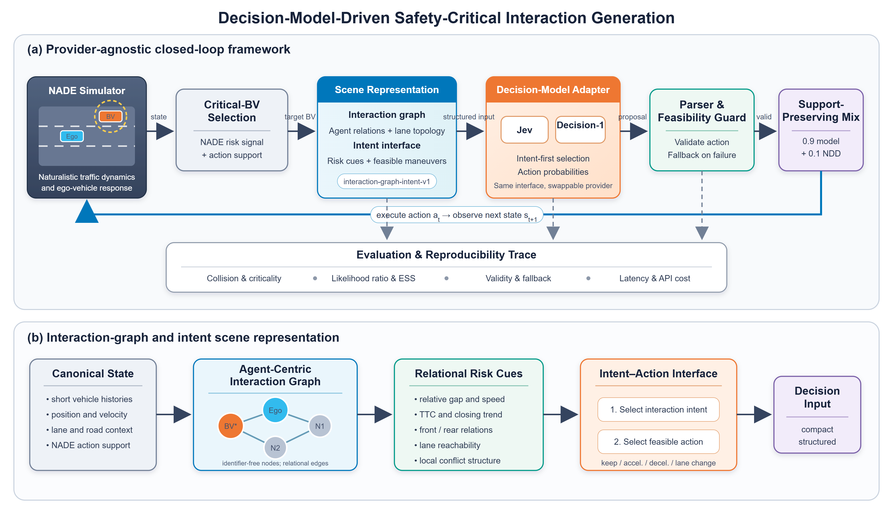

# Highway-CLI

Highway-CLI is a research framework for connecting decision models and language
models to closed-loop highway safety testing. It keeps critical-background-
vehicle selection and the executable NADE action support fixed while allowing a
configured model to select an interaction intent and a feasible action.



## What it provides

- A provider-neutral state and action interface.
- An agent-centric interaction-graph representation with relational risk cues.
- Jev and Decision-1 adapters plus an OpenAI-compatible adapter for other models.
- Strict response validation, format retries, fallback, and support-preserving
  action mixing.
- Swappable AV2 and IDM/MOBIL automated-vehicle policies.
- Resumable same-seed experiment manifests and auditable decision traces.
- Offline mock and replay workflows that require neither a model key nor NADE.

This repository is an anonymous release candidate. It contains framework code,
tests, example configurations, and documentation, but not private experiment
logs, API responses, model credentials, or the NADE repository.

## Five-minute offline quick start

Python 3.8 or later is required.

```bash
python -m venv .venv
```

Activate the environment, then install the package:

```bash
python -m pip install --upgrade pip
python -m pip install -e .
highway demo --representation interaction-graph-intent-v1
python -m unittest discover -s tests -v
```

The demo is deterministic, uses the built-in mock provider, and makes no network
request. On systems where console scripts are not immediately available, use
`python -m highway_cli` in place of `highway`.

## Using the public NADE environment

NADE is an external dependency and is not redistributed here. Obtain the public
repository separately:

```bash
git clone https://github.com/michigan-traffic-lab/Naturalistic-and-Adversarial-Driving-Environment.git ../nade-public
```

The compatibility environment used during development is documented in
`requirements-nade.txt`. PyTorch must be installed separately with a wheel
appropriate for the local platform.

```bash
highway doctor --nade-repo ../nade-public
highway baseline --nade-repo ../nade-public --episodes 1 --seed 0
highway experiment --nade-repo ../nade-public --provider mock \
  --decision-mode intent-hierarchical \
  --representation interaction-graph-intent-v1 \
  --episodes 1 --seed 0 --ndd-mix 0.1
```

NADE retains its own PolyForm Noncommercial license. See `THIRD_PARTY.md` before
using or redistributing any NADE component.

## Connecting a model

Configuration files contain only model metadata and the name of an environment
variable. Never put an API key in YAML, a command line, a trace, or a commit.

```bash
export OPENROUTER_API_KEY="your-key"
highway model-test --config configs/models/deepseek-openrouter.yaml
```

PowerShell:

```powershell
$env:OPENROUTER_API_KEY="your-key"
highway model-test --config configs\models\deepseek-openrouter.yaml
```

For local OpenAI-compatible servers, set `api_key_required: false` in a copied
configuration. Provider behavior and the structured output contract are
described in `docs/providers.md`.

## Main extension points

- Scene representations: `src/highway_cli/representations.py` and
  `src/highway_cli/interaction_graph.py`.
- Model adapters and validation: `src/highway_cli/model_config.py` and
  `src/highway_cli/nade_runner.py`.
- CAV policies: `src/highway_cli/cav_policies.py`.
- Resumable protocols: `src/highway_cli/baseline_runner.py` and
  `src/highway_cli/formal_runner.py`.

See `docs/architecture.md`, `docs/representations.md`, and
`docs/reproduction.md` for the scientific and implementation boundaries.

## Repository status

The framework passes 88 standard-library unit tests. The scientific protocol is
frozen; public-repository work should focus on documentation, packaging, clean-
environment reproduction, and privacy review. Do not change experiment logic or
published defaults without a separately reviewed protocol revision.

## License

Project-owned code in this repository is released under the MIT License. See
`LICENSE` for the full text.

The MIT grant covers only the code authored for this project. It does not
relicense NADE, its data, its pretrained models, or any other third-party
component; those retain their own terms. See `THIRD_PARTY.md` before using or
redistributing any NADE component.

The copyright holder is written as "The Highway-CLI Authors" to keep the
repository anonymous during double-blind review. The individual authors and
their institutional affiliation will be named in the public release.
